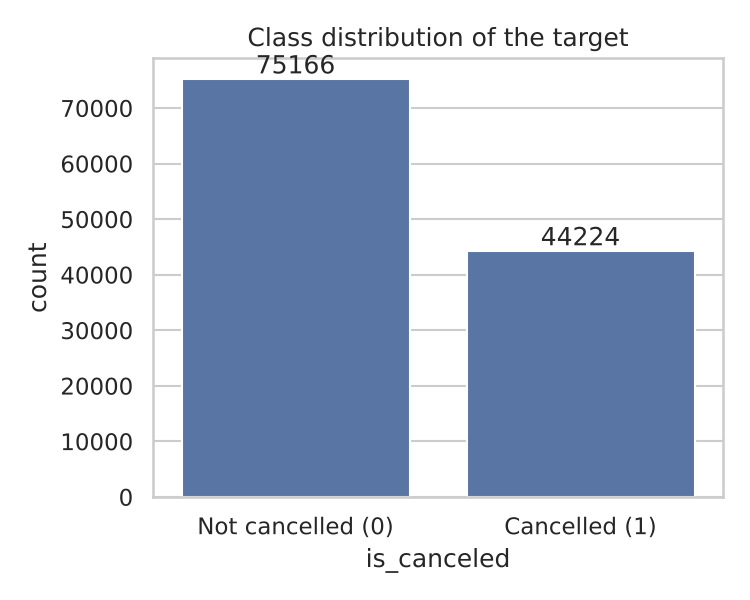
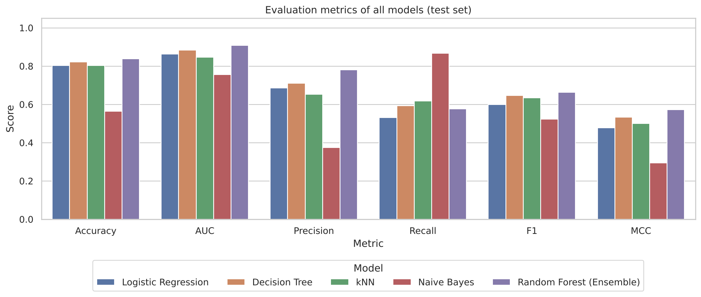
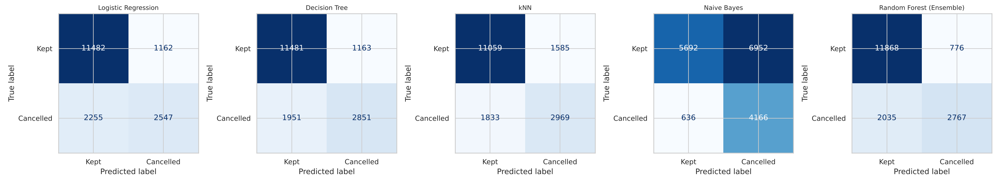
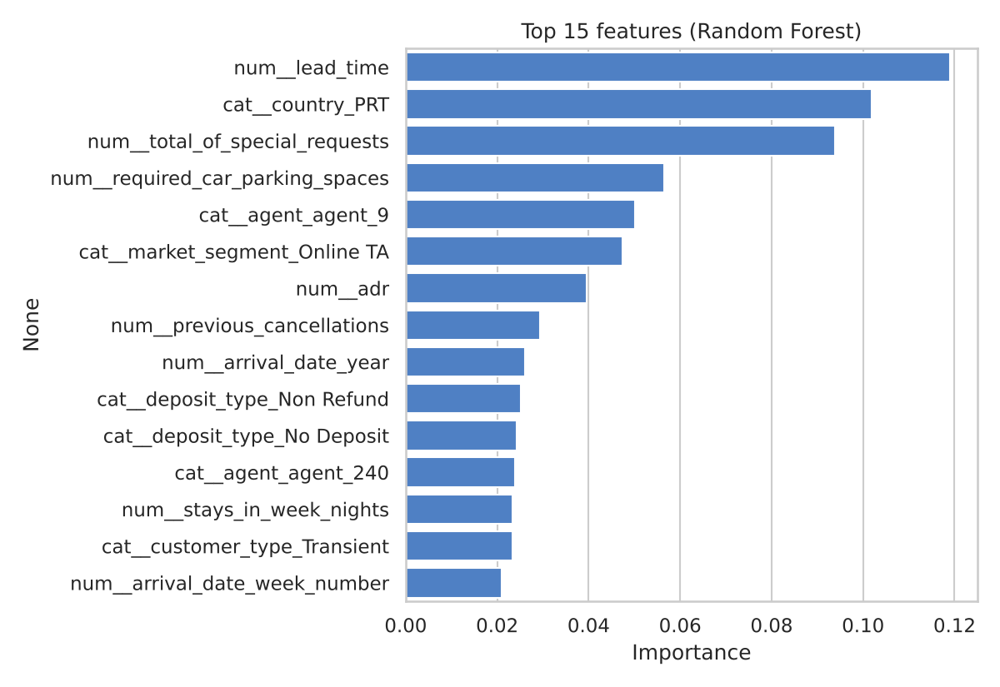

# Hotel Booking Cancellation Prediction: Comparing Five Classification Models

Machine Learning Assignment 2 (M.Tech AIML / DSE)

## 1. Problem Statement

A hotel loses revenue when a guest cancels at the last minute and the room stays empty. If cancellations can be predicted in advance, the hotel can plan overbooking, send reminders or ask for deposits. This project builds and compares five classification models that predict whether a booking will be cancelled (`is_canceled`: 1 = cancelled, 0 = not cancelled).

## 2. Dataset Description

| Item | Details |
|---|---|
| Source | Kaggle, *Hotel Booking Demand* (`hotel_bookings.csv`); originally Antonio, Almeida and Nunes (2019), *Data in Brief* |
| Instances | 119,390 raw rows; **87,230** after preprocessing |
| Features | 31 predictors in the raw data; **28 used** after removal of 2 leakage columns and 1 mostly empty column (17 numeric, 11 categorical) |
| Target | `is_canceled` (binary) |
| Class distribution | Raw data: 62.96% not cancelled / 37.04% cancelled. After removing duplicates: **72.48% / 27.52%** (moderate imbalance, about 2.6 : 1) |
| Missing values | `company` (94.3%, dropped), `agent` (13.7%, labelled "Missing"), `country` (0.4%, labelled "Missing"), `children` (4 rows, median imputation) |
| Duplicates | 31,994 duplicate rows (26.8%) removed |

**Why this dataset:** it exceeds the minimum 12 features and 1,000 instances, contains genuine missing values and class imbalance, mixes numeric and categorical features, and addresses a practical business problem.

**Data leakage:** `reservation_status` and `reservation_status_date` reveal the outcome after the fact (every "Canceled" or "No-Show" status is a cancelled booking), so they were removed.

## 3. GitHub Repository Link

https://github.com/MdFarzanRashid21/hotel-cancellation-ml

```
hotel-cancellation-ml/
|-- requirements.txt
|-- README.md
|-- test_data.csv
|-- results/            (plots and model_comparison.csv)
|-- model/
    |-- hotel_cancellation_classification.ipynb
    |-- logistic_regression.pkl, decision_tree.pkl, knn.pkl,
        naive_bayes.pkl, random_forest.pkl
```

### How to run
1. Download `hotel_bookings.csv` from Kaggle and place it in the repository root (or a `data/` folder).
2. `pip install -r requirements.txt`
3. Open `model/hotel_cancellation_classification.ipynb` and choose **Run All**.
4. Outputs: metrics table, plots (`results/`), saved models (`model/`), and `test_data.csv`.

## 4. Preprocessing

- Removed 31,994 duplicate rows and 166 bookings with zero guests.
- Dropped the leakage columns and the 94%-missing `company` column.
- Stratified 80:20 train-test split (69,784 train / 17,446 test rows) with a fixed random seed (219).
- Numeric: median imputation, then standardisation. Categorical: "Missing" label, then one-hot encoding (categories under 1% grouped together), giving 96 model inputs.
- All preprocessing is fitted on the training data only (inside a scikit-learn `Pipeline`), so no test information leaks into training.

## 5. Models Used

Model configurations:

| Model | Configuration |
|---|---|
| Logistic Regression | `max_iter=1000` |
| Decision Tree | `max_depth=10`, `min_samples_leaf=20` |
| kNN | `n_neighbors=7` |
| Naive Bayes | `GaussianNB()` defaults |
| Random Forest | `n_estimators=100`, `max_depth=18`, `min_samples_leaf=5` |

### Comparison table (test set, 17,446 bookings)

| ML Model Name | Accuracy | AUC | Precision | Recall | F1 | MCC |
|---|---|---|---|---|---|---|
| Logistic Regression | 0.8041 | 0.8624 | 0.6867 | 0.5304 | 0.5985 | 0.4787 |
| Decision Tree | 0.8215 | 0.8837 | 0.7103 | 0.5937 | 0.6468 | 0.5324 |
| kNN | 0.8041 | 0.8463 | 0.6520 | 0.6183 | 0.6347 | 0.5013 |
| Naive Bayes | 0.5651 | 0.7560 | 0.3747 | 0.8676 | 0.5234 | 0.2952 |
| Random Forest (Ensemble) | **0.8389** | **0.9086** | **0.7810** | 0.5762 | **0.6632** | **0.5716** |

### Visualisations







## 6. Observations

The test set holds 4,802 cancelled and 12,644 kept bookings.

| ML Model Name | Observation about model performance |
|---|---|
| Logistic Regression | A solid baseline: 80.4% accuracy and AUC 0.862. Its straight-line decision boundary cannot capture complex patterns, so it has the lowest recall of the balanced models (0.530) and misses 2,255 of the 4,802 real cancellations. |
| Decision Tree | Better than Logistic Regression on every metric (accuracy 82.2%, AUC 0.884, MCC 0.532) because it can model non-linear rules and feature interactions. Limiting the depth to 10 keeps it from memorising the training data, and it stays easy to explain. |
| kNN | Similar accuracy to Logistic Regression (80.4%) but a higher recall (0.618), so it catches more cancellations. It has the lowest precision of the four balanced models (0.652) with 1,585 false alarms, and it is the slowest at prediction time because it compares every booking with all training rows. |
| Naive Bayes | Catches the most cancellations (recall 0.868, 4,166 of 4,802) but raises 6,952 false alarms, so precision is only 0.375 and accuracy falls to 56.5%. It has the worst MCC (0.295). Its assumption that features are independent does not hold for this data (for example `country`, `agent` and `market_segment` are strongly related), and one-hot features make this worse. |
| Random Forest (Ensemble) | Best on accuracy (83.9%), AUC (0.909), precision (0.781), F1 (0.663) and MCC (0.572). Averaging many trees reduces the errors of a single tree, and it raises only 776 false alarms. Its weakness is recall (0.576): about 42% of real cancellations are still missed. The most important features are `lead_time`, `country` (Portugal), `total_of_special_requests` and `required_car_parking_spaces`. |
| **Overall winner for this dataset** | **Random Forest.** It has the best AUC and MCC, which are the fairest measures on imbalanced data, and the best balance between precision and recall (F1). Naive Bayes is only preferable if the hotel wants to catch as many cancellations as possible and accepts many false alarms. |
