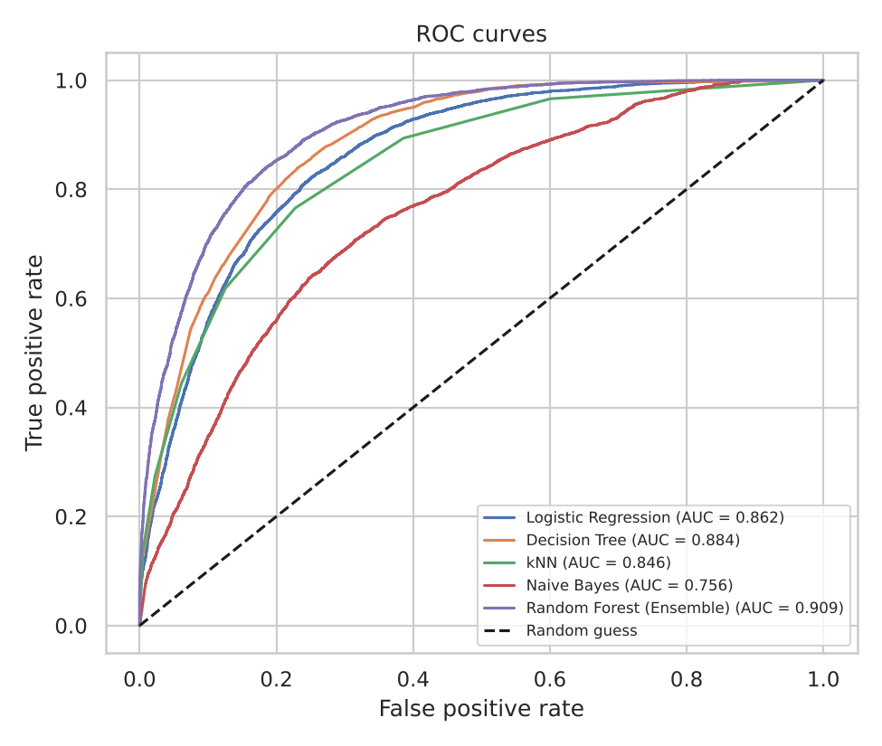

# Hotel Booking Cancellation Prediction: Comparing Five Classification Models

Machine Learning Assignment 2 (M.Tech AIML / DSE)

## 1. Problem Statement

A hotel loses revenue when a guest cancels at the last minute and the room stays empty. If cancellations can be predicted in advance, the hotel can plan overbooking, send reminders or ask for deposits. This project builds and compares five classification models that predict whether a booking will be cancelled (`is_canceled`: 1 = cancelled, 0 = not cancelled).

## 2. Dataset Description

| Item | Details |
|---|---|
| Source | Kaggle, *Hotel Booking Demand* (`hotel_bookings.csv`); originally Antonio, Almeida and Nunes (2019), *Data in Brief* |
| Instances | ~119,390 raw rows; <FILL: rows after cleaning> after preprocessing |
| Features | 31 predictors (<FILL: n> numeric, <FILL: n> categorical) |
| Target | `is_canceled` (binary) |
| Class distribution | <FILL: % not cancelled> / <FILL: % cancelled> (moderate imbalance) |
| Missing values | `company` (~94%, dropped), `agent` (~14%, labelled "Missing"), `country` (labelled "Missing"), `children` (median imputation) |
| Duplicates | <FILL: n> duplicate rows removed |

**Why this dataset:** it exceeds the minimum 12 features and 1,000 instances, contains genuine missing values and class imbalance, mixes numeric and categorical features, and addresses a practical business problem.

**Data leakage:** `reservation_status` and `reservation_status_date` reveal the outcome after the fact, so they were removed.

## 3. GitHub Repository Link

<FILL: [https://github.com/MdFarzanRashid21/hotel-cancellation-ml]

```
project-folder/
|-- requirements.txt
|-- README.md
|-- test_data.csv
|-- results/            (plots and model_comparison.csv)
|-- model/
    |-- hotel_cancellation_classification.ipynb
    |-- logistic_regression.pkl, decision_tree.pkl, knn.pkl,
        naive_bayes.pkl, random_forest.pkl
```

### How to run
1. Download `hotel_bookings.csv` from Kaggle and place it in the repository root (or a `data/` folder).
2. `pip install -r requirements.txt`
3. Open `model/hotel_cancellation_classification.ipynb` and choose **Run All**.
4. Outputs: metrics table, plots (`results/`), saved models (`model/`), and `test_data.csv`.

## 4. Preprocessing

- Removed duplicate rows and bookings with zero guests.
- Dropped leakage columns and the 94%-missing `company` column.
- Stratified 80:20 train-test split with a fixed random seed (<FILL: seed>).
- Numeric: median imputation, then standardisation. Categorical: "Missing" label, then one-hot encoding (categories under 1% grouped together).
- All preprocessing is fitted on the training data only (inside a scikit-learn `Pipeline`).

## 5. Models Used

Model configurations:

| Model | Configuration |
|---|---|
| Logistic Regression | `max_iter=1000` |
| Decision Tree | `max_depth=10`, `min_samples_leaf=20` |
| kNN | `n_neighbors=7` |
| Naive Bayes | `GaussianNB()` defaults |
| Random Forest | `n_estimators=100`, `max_depth=18`, `min_samples_leaf=5` |

### Comparison table (test set)

| ML Model Name | Accuracy | AUC | Precision | Recall | F1 | MCC |
|---|---|---|---|---|---|---|
| Logistic Regression | | | | | | |
| Decision Tree | | | | | | |
| kNN | | | | | | |
| Naive Bayes | | | | | | |
| Random Forest (Ensemble) | | | | | | |

### Visualisations





## 6. Observations

| ML Model Name | Observation about model performance |
|---|---|
| Logistic Regression | <FILL> |
| Decision Tree | <FILL> |
| kNN | <FILL> |
| Naive Bayes | <FILL> |
| Random Forest (Ensemble) | <FILL> |
| **Overall winner for this dataset** | <FILL> |
